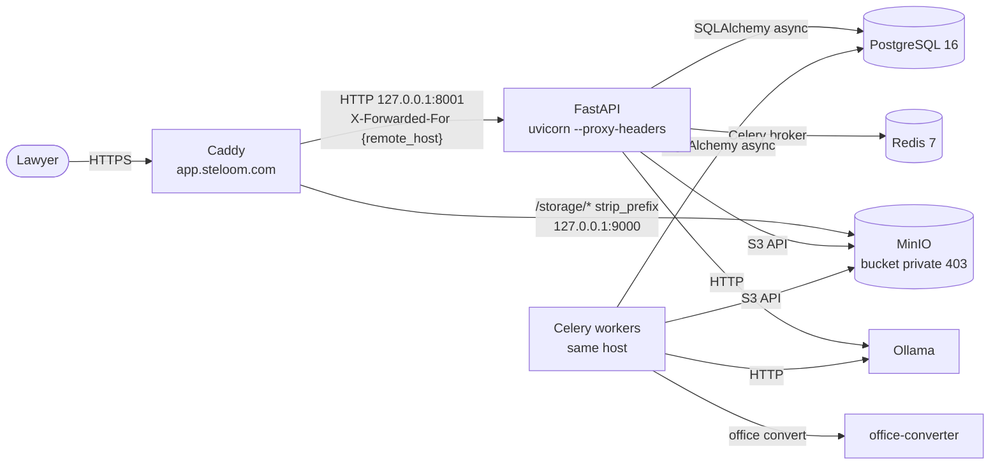
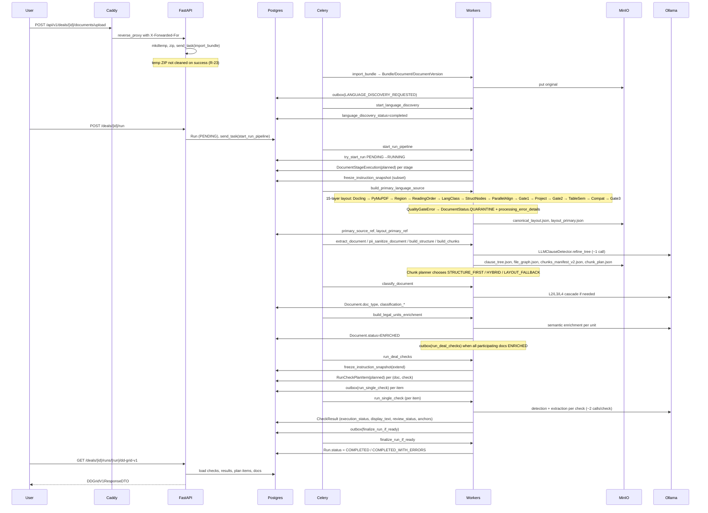

# Steloom / LegalMAS — Diagrams

**Document:** DIAGRAMS (Architecture Visualizations)
**Version:** 1.0
**Date:** 2026-10-26
**Snapshot:** audited baseline `f22e3ba`; HEAD at completion `e1325f9`
**Companion to:** `TECHNICAL_OVERVIEW.md` §5.1 (System context) and §6 (Document → DD Grid path)

Standalone file with the two architectural diagrams. Rendered by GitHub / GitLab / VS Code Mermaid extension / Obsidian / mermaid.live. Extracted from `TECHNICAL_OVERVIEW.md` for clarity and for use in slide decks / investor packs.

---

## 1. System context

**Scope:** API, workers, Caddy, MinIO, PostgreSQL, Redis, Ollama, office-converter — deployment on single host with Docker infrastructure.

**What it shows:**
- Caddy terminates HTTPS at `app.steloom.com`, reverse-proxies `/api/*` to `uvicorn` (port 8001) with `X-Forwarded-For {remote_host}` — Caddy overwrites client-supplied XFF header, uvicorn `--forwarded-allow-ips=127.0.0.1` trusts only Caddy.
- `/storage/*` proxy to MinIO (bucket private — `403` on direct access); R-40 LOW recommendation to remove this block.
- FastAPI, Celery workers (same host), and background tasks all connect to PostgreSQL 16 via SQLAlchemy async, MinIO via S3 SDK, Ollama via HTTP.
- office-converter is an isolated LibreOffice HTTP microservice (non-root `appuser`, per-request `profile_dir`, `--headless --nologo --norestore` — see T-OFFICE-1 in THREAT_MODEL.md).



**Trust boundaries:**
- User ↔ API: HTTPS via Caddy; client XFF is overwritten (`{remote_host}`).
- API ↔ internal: localhost only, no auth between API and PG/Redis/MinIO/Ollama.
- Client documents: untrusted input; prompt injection delimiters in 3 prompt files (R-17 FIXED, residual LOW).
- `/storage/*` endpoint: bucket private (`403`), exposed as Caddy route (R-40 LOW).
- `/ws/*`: dead Caddy block, no matching FastAPI endpoint (R-41 INFO).

**End-to-end verification:** E102 (17.5 min synthetic contract), E105 (15.2 min dev run). Q6 rate-limit fix verified pre/post deploy: `5×401 + 2×429` (E75, E103). Race condition 409 verified end-to-end (E106).

---

## 2. Document → DD Grid path

**Scope:** Full lifecycle from HTTP upload to DD Grid response, spanning Caddy, FastAPI, Postgres, Celery, Workers, MinIO, Ollama.

**What it shows:**
- User uploads via `POST /api/v1/deals/{id}/documents/upload` → temp ZIP → async `import_bundle` Celery task.
- Language discovery → pipeline start (`POST /deals/{id}/run`) → stage-by-stage processing (layout → extract → PII → structure → chunks → classify → enrich → checks → finalize).
- 15-layer layout pipeline with 3 quality gates; `QualityGateError` → QUARANTINE.
- LLM call sites: `LLMClauseDetector.refine_tree` (~1 call per doc), L2/L3/L4 classification cascade, per-unit semantic enrichment, per-check detection + extraction (~2 calls/check).
- `outbox(...)` pattern between stages — durable dispatch; `DocumentStageExecution(planned)` ledger per stage.
- R-33 migration `bf78307e1293`: partial unique index `uq_runs_one_active_per_deal WHERE status IN ('pending','running')` — second concurrent `/run` → 409 Conflict + `X-Active-Run-Id` header (both `/deals/{id}/run` and `/playbook/rebuild-and-rerun`).



**Observed end-to-end (E102, 2026-10-26):**
- Synthetic `Sample_Contract.DOCX` (18 pp., `contract_1.6_real_estate`, confidence 0.95)
- Duration **17.5 min** (12:29:35 → 12:47:05 UTC)
- 21 checks scheduled / 21 completed; `has_errors=false`
- 42 validated anchors (34 `exact_span` + 8 `fuzzy_span`); 19 `clause_only`
- 37 LLM calls (`qwen2.5:14b` on Ollama, 100% GPU — 49/49 layers offloaded)
- Full audit trail: IMPORT → LANGUAGE_DISCOVERY_STARTED/COMPLETED → ANALYSIS_STARTED → PRIMARY_SOURCE_READY → SANITIZE → CHUNK_BUILD_COMPLETED → CLASSIFY_COMPLETED → STRUCTURE_COMPLETED → LEGAL_UNITS_ENRICHMENT_COMPLETED → ANALYSIS_COMPLETED → result_presentation.requested/claimed/translated

**Second run (E105, dev, post-R-33/R-49/R-03/R-52 fixes):**
- Same synthetic contract; **15.2 min**; 21/21 checks; **43 anchors** (35 `exact_span` + 8 `fuzzy_span`); 46 LLM calls (20 extraction + 21 translations + 5 misc)
- Backend logs clean — no `IntegrityError`, no `Traceback`
- Confirms R-33/R-52/R-49/R-03 fixes did not break pipeline

**Race guard (E106, R-33 + R-52):**
- Second concurrent `POST /deals/{id}/run` (with existing PENDING run) → `409 Conflict`, `X-Error-Code: DEAL_ALREADY_HAS_ACTIVE_RUN`, `X-Active-Run-Id: <uuid>` — curl-verified on dev
- Same behavior on `POST /playbook/rebuild-and-rerun`
- `await db.rollback()` in exception handler prevents orphan `PlaybookVersion` (R-52); `deal_tenant_id_str` cached before rollback to avoid `MissingGreenlet` (commit `e1325f9`)

---

## 3. Not covered

- **Data model ER diagram** — see `TECHNICAL_OVERVIEW.md` §8 (`erDiagram` for TENANTS / DEALS / RUNS / CHECK_RESULTS / anchors / presentations).
- **Deployment topology** (systemd units, Caddy config, backup rotation) — see `TECHNICAL_OVERVIEW.md` §13 (text only).
- **Threat model** — see `internal/THREAT_MODEL.md` (18 threats, threat matrix, 0 HIGH open).
- **Detailed AI pipeline** (L1/L2/L3 scoring, grounding, anchor resolution) — see `TECHNICAL_OVERVIEW.md` §7.
- **Full risk register** — see `QUALITY_AND_RISKS.md` §6 (51 risks: 9 CLOSED, 42 open/accepted).

---

## 4. Rendering

These diagrams use Mermaid syntax. To render:

- **GitHub / GitLab:** auto-rendered in markdown preview.
- **VS Code:** install "Markdown Preview Mermaid Support" extension.
- **Obsidian:** native support.
- **mermaid.live:** paste the block between ` ```mermaid ` and ` ``` ` for interactive editing / export to SVG/PNG.
- **CLI:** `mmdc -i DIAGRAMS.md -o out/` (mermaid-cli) for batch rendering.

Visuals reflect code at HEAD `e1325f9` (18 commits over audited baseline `f22e3ba`). Not an independent audit — companion visual aid to the review pack.

---

*End of DIAGRAMS. Snapshot CONFIRMED at `f22e3ba`; HEAD at completion `e1325f9`. Diagrams extracted from TECHNICAL_OVERVIEW.md §5.1 + §6. Rendered by GitHub / GitLab / VS Code / Obsidian / mermaid.live. 0 HIGH open in current risk register (51 risks: 9 CLOSED).*
