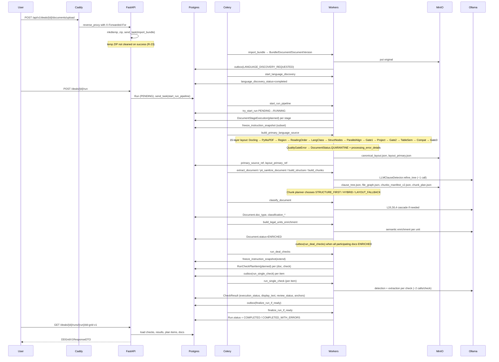
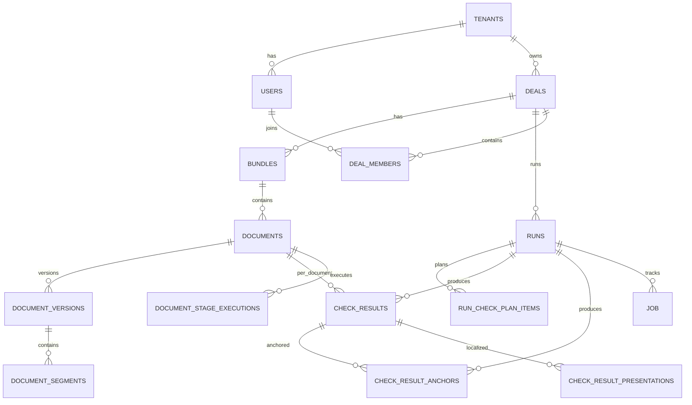

# Steloom / LegalMAS — Technical Overview

**Document:** TECHNICAL_OVERVIEW (Architecture and Code Guide)
**Version:** 1.5
**Date:** 2026-10-26
**Snapshot (audited baseline):** CONFIRMED — branch `master`, HEAD `f22e3ba1b82348ba1208bd7de8f183ff5331df57` (2026-10-26)
**HEAD at completion:** `e1325f9` (18 post-snapshot commits; see §11). HANDOVER v7.8 referenced `d692e18`; diff = 182 files, +159,922 / −53,613 lines, 79 non-merge commits.
**Deployed demo:** HEAD `e1325f9`, deployed 2026-10-26T17:13:48 UTC; authoritative `/srv/steloom-demo/.deploy-meta.json` (E103, E106, R-38 CLOSED)
**Fix log:** Q6 `--proxy-headers --forwarded-allow-ips=127.0.0.1` applied 2026-10-26T10:46 UTC (E75); Q9 compact `<UNTRUSTED_DOCUMENT_TEXT>` delimiters applied 2026-10-26 to 3 prompt files, smoke-tested (E97); DB schema verified VARCHAR(50) (E90); Tier 1 pytest 131/131 passed (E99, E100); Tier 2 security regression 3/3 passed (E101); end-to-end pipeline run 17.5 min on synthetic doc (E102); deploy hardening R-38/R-39/R-46 closed 2026-10-26T14:07 UTC (E103) — demo deployed at HEAD 763f2d9; threat model v1.0 + R-07 CLOSED (E104); dev end-to-end run 15.2 min + race 409 verified (E105, E106); R-33/R-49/R-52/R-03 CLOSED; demo re-deployed at e1325f9 2026-10-26T17:13 UTC (E106)
**Review mode:** static + targeted Q6 runtime verification + DB schema check + Tier 1+2 pytest + end-to-end run
**Status:** Final for investor delivery
**Methodology:** AI-assisted static analysis + owner-executed verification. Not an independent audit.

## 1. Scope

Steloom (LegalMAS) is a multi-tenant SaaS for AI-assisted legal due diligence on M&A-style document sets. Core path:

`upload → language discovery → layout & PII → structure (segmentation + clause tree) → chunk → classify → playbook checks → DD Grid → export`.

**Not covered in depth** (see §14 and `internal/REVIEW_WORKLOG.md`):
- `src/services/structure/_element_classifier/`, `_heading_builder/`, `_heading_scoring/`, `_hierarchy_builder/`, `_models/` (except `_identity.py`), `semantic_enrichment/`, `coherence/`, `cohesion/`, `chunk_planner/_types.py`, `_clause_detector/routing.py` — ~70 files.
- Full alembic migration history (~150; 4 viewed: initial, jobs unique, plan_items unique, schema_drift).
- Frontend beyond DD Grid V1 (marketing pages, admin/tenant pages, most hooks/stores).
- `aws/`; `monitoring/` deep stack (only `alerts/*.yml` read).
- `docs/AUDIT_FINAL_2026-10-17.txt` — scope: playbook YAML only. Not an app audit (R-36, S-09).

## 2. Capability matrix

| Feature | Impl. | Entry | Evidence | Limitations |
|---|---|---|---|---|
| Multi-tenant users/deals | Active | `api/deps/security.py`, `db/models/tenant.py` | STATIC + EXECUTED (E102) | Some endpoints lack audit (R-02) |
| JWT auth | Active | `api/deps/auth.py`, `services/auth_service.py` | STATIC | No revocation, no refresh, 8h TTL (R-01) |
| Project roles | Active | `require_project_role` | STATIC | `tenant_admin` bypasses |
| Multi-doc upload | Active | `deals/documents.py` | STATIC + EXECUTED (E102) | `mkdtemp` not cleaned on success (R-23) |
| Language discovery | Active | `workers/*language*` | STATIC + EXECUTED (E102 — RU) | Mandatory precondition |
| Layout pipeline (Docling) | Active (V2 default) | `document_layout/service.py` | STATIC + EXECUTED (E102 — 18 pp.) | 15 layers; 3 gates; `QualityGateError` → QUARANTINE |
| Segmentation (`_segmenter/`, 11 files) | Active | `segmenter.py:segment_elements()` (public facade) | STATIC + EXECUTED (E102) | MAX_REASONABLE_SEGMENTS=15 enforced in facade; V2 anchor path dormant (R-43) |
| Structure / clause tree | Active | `structure/builder.py` → `_core_builder.py` | STATIC + EXECUTED (E102 — STRUCTURE_COMPLETED) | — |
| LLM clause detection | Active | `_clause_detector/detector.py:LLMClauseDetector.refine_tree()` | STATIC + EXECUTED (E102 — 1 call) | ~1 LLM call per document + numeric fallback merge |
| Chunk planner | Active | `chunk_planner/_planner.py` | STATIC + EXECUTED (E102 — CHUNK_BUILD_COMPLETED) | 3 modes; mode C not alerted (R-34) |
| Boundary-aware chunking | Active | `engine/content/chunking.py` | STATIC | Legacy fallback |
| Classification (L1–L4 cascade) | Active | `stage8/hybrid_classifier.py`, `l1_filename.py`, `l2_header.py`, `l3_semantic.py`, `_cascade_steps.py` | STATIC + EXECUTED (E102 — 0.95 conf, contract_1.6_real_estate) | — |
| Playbook-driven checks | Active | `engine/checks/*` | STATIC + EXECUTED (E102 — 21 checks) | — |
| Instruction snapshot (strict) | Active | `instruction_snapshot.py` | STATIC | Two-phase freeze |
| DD Grid V1 | Active | `dd_grid_v1_builder.py`, `deal_review_service.py` | STATIC + EXECUTED (E102 — 21/21 with anchor) | Contract doc partially stale (S-05/06/07) |
| Risk-aware DD Grid | Active | `_compute_cell_risk` | STATIC | Not in v1 contract |
| QC (single + bulk) | Active | `qc.py`, `review_qc_service.py` | STATIC | `qc_by` uses email |
| DD requests | Active | `requests.py` | STATIC | Legacy UI removed |
| Exports (Excel/Word/JSON) | Active | `exports.py`, `export/service.py` | STATIC | PDF `inline`; download not audited (R-13) |
| Result presentation translation | Active | `result_presentation_worker.py` | STATIC + EXECUTED (E102 — 12 calls) | LLM-based; quality not measured |
| Embedding service | Active | `embedding_service.py` | STATIC | BGE-M3; optional cache off |
| Observability stack | Configured | `monitoring/` | STATIC | LLM alerts sleeping (R-32) |
| CI for tests | **Absent** | `.github/workflows/dependency-audit.yml` only | STATIC | Only pip-audit |
| PII key rotation | **Absent** | `pii_encryption.py` | STATIC | R-10 |
| JWT revocation | **Absent** | `api/deps/auth.py` | STATIC | R-01 |
| Backup rotation | **Active** | `deploy/deploy-demo.sh:rotate_backups()` | EXECUTED (E103) | retention 30d + keep latest 10; 42→12 dirs, 15 GB→4.4 GB (R-39 CLOSED) |
| Rollback script | **Absent** | `deploy/` | STATIC | R-28 |
| Word add-in | Planned | — | — | Not in code |
| Legislation monitoring | Planned | — | — | Not in code |
| External integrations | Planned | — | — | Not in code |

## 3. Technology inventory

**Declared:** Python `>=3.11`; FastAPI `0.115.6`; SQLAlchemy `2.0.36` async; asyncpg; Alembic; Celery `5.4.0` + Redis `5.2.1`; MinIO client; pydantic `2.10.4`; sentence-transformers `3.3.1`; transformers `4.49.0`; `torch 2.5.1+cpu`; llama-cpp-python; tiktoken; docling family `2.121.0`; PDF/OCR: pdfplumber, pdf2image, pytesseract, PyMuPDF `1.28.2`; PII: cryptography `44.0.0`, natasha, langdetect, lingua; retrieval: rank-bm25, rapidfuzz, thefuzz, python-Levenshtein; observability: prometheus-client, opentelemetry `1.28.2`; `setuptools<81`.

**Runtime (deployed):** GPU — RTX 5060 Ti 16GB, CUDA 13.2, `torch 2.13.0+cu130`, Ollama 100% GPU (49/49 layers offloaded, journal 2026-10-26 12:24 UTC). Declared CPU default in `requirements.txt` (`torch==2.5.1+cpu`); deployed via `make install-runtime-gpu`. At E102, Ollama served `qwen2.5:14b` (base model — deviation from documented `qwen25-legal`) with all layers on GPU.

**Not confirmed:** actual demo runtime versions; prod GPU; exact LLM model in production.

## 4. Module map

| Path | Responsibility | Entry | Tests |
|---|---|---|---|
| `src/api/` | FastAPI app | `main.py:app` | `tests/api/` (3 viewed) |
| `src/core/` | Config, logging, tracing, anchors | `config.py:Settings` | partial |
| `src/classifiers/` | L1–L4 cascade | `stage8/hybrid_classifier.py` | `tests/classifiers/` |
| `src/engine/checks/` | Check execution, result semantics | `check_runner.py`, `result_semantics.py` | `tests/engine/checks/`, `tests/unit/engine/checks/` |
| `src/engine/content/` | Chunking, citation, boundary-aware splitting | `document_content_service.py`, `chunking.py` | `tests/engine/content/` |
| `src/engine/detectors/` | Rules/LLM/hybrid + extraction LLM | `hybrid_detector.py`, `extraction_llm_detector.py` | `tests/unit/engine/detectors/` |
| `src/engine/llm/` | LLM client | `client.py:LLMClient` | `tests/unit/engine/llm/` |
| `src/engine/playbook/` | Playbook models/loader | `models.py`, `loader.py` | `tests/unit/engine/playbook/` |
| `src/engine/retrieval/` | BM25 + dense + metadata | `engine.py:RetrievalEngine` | `tests/unit/engine/retrieval/` |
| `src/services/document_layout/` | 15-layer layout | `service.py:prepare_document_layout()` | `tests/services/document_layout/` |
| `src/services/structure/` | Clause tree + Phase 10 chunk planner | `builder.py` → `_pipeline/_core_builder.py` | `tests/services/structure/` |
| `src/services/structure/_segmenter/` | Boundary-layer segmentation (11 files) | `_pipeline/_segment_utils.py:segment_document()` → `segmenter.py:segment_elements()` | `tests/services/structure/` |
| `src/services/structure/_clause_detector/` | LLM clause detection + fallback | `detector.py:LLMClauseDetector.refine_tree()`, `parser.py` | `tests/services/structure/` |
| `src/services/embeddings/` | SentenceTransformer, BGE-M3, optional cache | `embedding_service.py:encode()` | `tests/services/embeddings/` |
| `src/services/export/` | Export record lifecycle + audit | `service.py:run_export_for_record()` | `tests/unit/services/export/` |
| `src/services/deal_review_service.py` | DD Grid orchestration + DatabaseInstructionProvider invariant | `build_dd_grid_v1_response()` | partial |
| `src/db/` | ORM models, repositories | `models/__init__.py`, `repositories/` | various |
| `src/workers/` | Celery tasks (thin adapters) | `celery_app.py` | `tests/workers/` |
| `src/mas_queue/` | Celery config, base task, dispatcher, outbox | `celery_app.py`, `base_task.py` | `tests/unit/mas_queue/` |
| `src/storage/` | MinIO artifact store | `artifact_store.py` | `tests/storage/` |
| `src/ops/` | Metrics, instrumentation (API `/metrics` only) | `metrics.py`, `instrument.py` | — |
| `frontend/` | React + AG Grid UI | `src/pages/`, `src/api/` | `frontend/tests/` |

## 5. Architecture

### 5.1 System context

```mermaid
flowchart LR
    User([Lawyer]) -->|HTTPS| Caddy[Caddy<br/>app.steloom.com]
    Caddy -->|HTTP 127.0.0.1:8001<br/>X-Forwarded-For {remote_host}| API[FastAPI<br/>uvicorn --proxy-headers]
    Caddy -->|/storage/* strip_prefix<br/>127.0.0.1:9000| MinIO[(MinIO<br/>bucket private 403)]
    API -->|SQLAlchemy async| PG[(PostgreSQL 16)]
    API -->|Celery broker| Redis[(Redis 7)]
    API -->|S3 API| MinIO
    API -->|HTTP| Ollama[Ollama]
    Workers[Celery workers<br/>same host] -->|SQLAlchemy async| PG
    Workers -->|S3 API| MinIO
    Workers -->|HTTP| Ollama
    Workers -->|office convert| Office[office-converter]
```

Trust boundaries:
- User ↔ API: HTTPS via Caddy.
- API ↔ internal: localhost (no auth).
- Client documents: untrusted input; compact `<UNTRUSTED_DOCUMENT_TEXT>` delimiters + security line applied 2026-10-26 to 3 prompt files (E97). Residual LOW: delimiter escape not sanitized.
- Any `editor` can trigger PII reveal; no separate `can_reveal_pii` flag (R-04, ACCEPTED + PLANNED).
- `/storage/*` proxy to MinIO exists; bucket private (`403`); recommended removal (R-40, LOW).
- `/ws/*` dead block in Caddyfile (R-41, INFO).

### 5.2 Container / runtime

- **API** — uvicorn 2 workers on `127.0.0.1:8001`; `--proxy-headers --forwarded-allow-ips=127.0.0.1` (Q6 fix, E75).
- **Workers** — Celery queues: `default`, `high_priority`, `system`, `low_priority`, `heavy_llm_enrichment`, `heavy_llm_segment_classification`, `heavy_llm_checks`.
- **office-converter** — LibreOffice HTTP microservice.
- **Observability** — `docker-compose.monitoring.yml`; 13 alert rules; LLM alerts sleeping (R-32).
- **Caddy** — `/etc/caddy/Caddyfile`; `/api/*` reverse_proxy with `X-Forwarded-For {remote_host}`; `/storage/*` proxy to MinIO; `/ws/*` dead block (R-41); root → frontend dist.

## 6. Document → DD Grid path



**Caveat:** two check-scheduling paths — batch (`run_deal_checks`, guarded by unique `Job`) and per-doc (`run_document_checks`, no `Job`). Both use `RunCheckPlanItem.create_planned`; unique partial indexes exist (migration `bc56177ec084`); `IntegrityError` not caught (R-08, LOW).

**Observed at E102** (2026-10-26, synthetic 18-pp. contract): full sequence above executed in **17.5 min**; `pipeline_strategy=REUSE_STRUCTURE`, `checks_mode=global_and_doc_type`; 21 checks scheduled and completed; `audit_logs` shows complete lifecycle from IMPORT → ANALYSIS_COMPLETED.

### 6.1 Layout pipeline (15 layers)

1. Docling extraction (CPU-only singleton, thread-safe lock, SHA256, preserves Docling marker).
2. PyMuPDF enrichment.
3. Page region segmentation (Layer 1, height-gating 25%).
4. Reading order (Layer 2).
5. Language classification (Layer 3).
6. Structural nodes (Layer 4).
7. Parallel alignment (Layer 5).
8. **Gate 1** canonical.
9. Save `canonical_layout.json`.
10. Monolingual projection (Layer 8).
11. **Gate 2** projection.
12. Table semantics + span splitter (Layers 6, 7).
13. Compatibility builder (Layer 10).
14. **Gate 3** compatibility.
15. Save `layout_primary.json`.

Spatial marker recovery compensates for Docling issue #1345. Gate failure → `QualityGateError` → QUARANTINE + `processing_error_details` (`build_primary_language_source.py:319-390`); no `LAYOUT_QUARANTINED` audit event (R-31, LOW-MEDIUM).

### 6.2 Structure pipeline

`build_file_structure()` → `_core_builder.py:build_file_structure()`:
1. `clean_elements()` → `_classify_elements_safe()` → `segment_document()`.
2. Per segment: `build_single_segment_tree()` → `validate_element_contract` → `build_heading_candidates` → `analyze_toc_with_guard` → `annotate_elements_with_guard` → `run_phase2` → `_filter_toc_zone_headings_when_body_headings_exist` → `build_clause_hierarchy` (FSM) → `LLMClauseDetector.refine_tree()` → `build_cross_reference_graph_with_audit` → `compute_structure_assessment` → `decide_structure_gate`.
3. `CrossSegmentCoherenceResolver.resolve()` if >1 segment.
4. `build_file_graph()`.

### 6.2.1 Segmentation (`_segmenter/`, 11 files)

`segment_document()` (`_pipeline/_segment_utils.py`) delegates to public facade `segmenter.py:segment_elements()`, which orchestrates the `_segmenter/` pipeline. Facade guarantees: never raises, always ≥1 segment, enforces `MAX_REASONABLE_SEGMENTS=15` (single-segment fallback), enforces `SEGMENT_CONFIDENCE_THRESHOLD` (default 0.70 from settings) for accepted candidates.

Pipeline:

1. **`detect_repeated_page_artifacts`** — page-level artifact indices (running headers).
2. **`build_boundary_suppression_context`** — page-level suppression of appendix/amendment families on TOC/catalog pages.
3. **`collect_boundary_candidates`** — accumulates `BoundarySignal` per candidate. Score = `max(0, min(sum(weights), 1.0))`. Signals:

   | Signal | Weight | Condition |
   |---|---|---|
   | `boundary_keyword` | +0.45 | appendix/amendment/act/invoice/protocol regex matched |
   | `page_break` | +0.20 | first element on page |
   | `numbering_reset` | +0.20 | numbering restarts (1/I/A) after progression |
   | `formatting_shift` | +0.10 | all_caps / centered / font_size ≥ 13 |
   | `heading_density_shift` | +0.10 | heading count jumps after element |
   | `element_type_heading_candidate` | +0.10 | classifier labeled heading |
   | `segment_start_context` | +0.10 | page_offset ≤ 2 |
   | `heading_like_marker` | +0.05 | heuristic heading detection |
   | `appendix_boundary` | +0.12 | appendix marker |
   | `appendix_series_start` | +0.08 | first appendix in series |
   | `element_type_list_item_penalty` | −0.20 | classifier labeled list_item |

   Filters inside collection:
   - `_is_part_of_local_swarm` — 2+ same-family markers within ±4 elements and no substantive body → reject.
   - `detect_body_internal_boundary_listing` — intro-verb nearby + ≥2 same-family entries → reject.
   - `suppression_context.suppresses_boundary_family(page, family)` — TOC/catalog suppression.
   - `is_boundary_position` — accepted positions only.

4. **TOC/catalog suppression** (`toc_suppression.py`) — page-level `BoundarySuppressionContext` with 6 topological heuristics: `toc_header_with_catalog_block`, `toc_page_with_multiple_catalog_entries`, `dense_toc_lines_without_explicit_header`, `catalog_header_with_dense_compact_entries`, `dense_catalog_entry_cluster_without_body_text`, `contiguous_entry_cluster_violates_document_physics`.

5. **`validate_boundary_candidates`**:
   - Reject mid-paragraph refs.
   - Reject `score < WEAK_BOUNDARY_THRESHOLD (0.45)`.
   - `MIN_ELEMENTS_BETWEEN_BOUNDARIES (3)` proximity.

6. **`recover_segment_purity_candidates`** (P1) — up to 3 iterations.

7. **`build_segments_from_candidates`** — `boundaries = [0] + candidates`.

8. **`assign_primary_segment`** → **`attach_scope_names`** → **`propagate_segment_metadata`**.

**V2-aware path** (`_collect_v2_anchor_boundaries`): detects V2 format (>30% elements with `metadata.anchor_uid`); **dormant** (R-43).

**Fallback chain:** exception → single; empty → single; invalid ranges → single; all-empty-content → single; `>MAX_REASONABLE_SEGMENTS` → single.

### 6.3 Chunking pipeline

`plan_chunking(analysis)` chooses mode from Phase 9 report:

| Mode | Section chunks | Subclause split | Drop fallback nodes |
|---|---|---|---|
| STRUCTURE_FIRST | Yes | Yes | No |
| HYBRID | No | Yes | Yes |
| LAYOUT_FALLBACK | No | No | Yes |

Boundary-aware splitter with legacy fallback.

## 7. AI / LLM pipeline

**Providers** (`engine/llm/client.py`): `openai`, `ollama` (JSON mode via `format=json`), `llamacpp` (GBNF, `Semaphore(1)`), `none`.

**Model selection:** `LLM_OLLAMA_MODEL` (detection), `STRUCTURE_LLM_MODEL` (structure refiner), `RUNNER_EMBEDDINGS_MODEL` (default `BAAI/bge-m3`), `EMBEDDING_MAX_INPUT_TOKENS=8192`.

**Observed at E102:** dev ran `qwen2.5:14b` (not `qwen25-legal`). 37 LLM calls for 21-check single-document run:

| Stage | Calls | Prompt tokens | Completion tokens |
|---|---|---|---|
| `checks_extraction_llm` | 20 | 130,022 | 11,671 |
| `result_presentation_translation` | 12 | 8,036 | 3,153 |
| `run_summary_pass_a` | 1 | 2,069 | 1,415 |
| `run_summary_pass_b` | 1 | 3,191 | 823 |
| `structure_clause_detection` | 1 | 2,548 | 374 |
| `structure_semantic_enrichment` | 1 | 2,827 | 161 |
| `classification_l4` | 1 | — | — |
| **Total** | **37** | **~148k** | **~17.6k** |

**Context building:** BM25 + dense + metadata (weights `0.3/0.6/0.1`); context budget `LLM_CONTEXT_LIMIT - max_tokens - safety_margin - skeleton_tokens`; extraction reserves `_EXTRACTION_TOKEN_FACTOR = 3.8`.

**Embedding:** SentenceTransformer singleton; per-text cache (SHA256) when `EMBEDDING_CACHE_ENABLED=true` (default off).

**Structured output:**
- Detection: JSON → markdown → brace match; heuristic on failure.
- Extraction: `_salvage_partial_json` (3 passes); `_truncated=True` written by backend, not read by frontend (R-18).

**Grounding** (`_calculate_grounding_score`): exact 1.0; token-overlap ratio; `<0.1` → suppressed; `0.1–0.3` → cap 0.7; `≥0.3` → anchor.

**Citation anchor:** `EXACT_SPAN` (1.0) → `FUZZY_SPAN` → `CLAUSE_ONLY` (0.5) → `PAGE_ONLY` (0.3) → `NONE`. `_MIN_QUOTE_LEN=8`, `_MIN_FUZZY_QUOTE_TOKENS=3`, `_FUZZY_MAX_WINDOW_MULTIPLIER=2.5`.

**Observed at E102:** 42/42 span-anchors validated (34 exact_span + 8 fuzzy_span), 19 clause_only (no span to validate — expected). All 21 check_results have `primary_anchor_id`.

**Reproducibility:** `Run.instruction_snapshot_*` + `snapshot_schema_version`. Strict mode (`>=1`) forbids filesystem fallback → `ConfigurationIntegrityError`. Legacy (`NULL`) → `is_reproducible=False`.

**LLM call sites (~50 per 23-check document with 1 locale) — refined by E102 (37 for 21-check):**

| Site | Count (E102) |
|---|---|
| Classification L4 | 1 |
| Detection LLM | 0 (rules-only at E102) |
| Extraction LLM | 20 |
| Semantic enrichment | 1 |
| Clause detection | 1 |
| Structure refiner | 0 |
| Summary (pass A + B) | 2 |
| Translation | 12 |

Aggregate cost not exposed in UI — per-check `llm_usage_events` recorded (R-33).

**Prompt structure:** `generic_presence.txt`, `classify_document.txt`, `structure/clause_detection.txt` use `str.replace()`; **compact `<UNTRUSTED_DOCUMENT_TEXT>` delimiters + security line applied 2026-10-26** (E97). Runtime L4 budget (E98): `LLM_CONTEXT_LIMIT=12288`, `skeleton_tokens=3778`, `fragment_budget=7756`, overhead_ratio=32.8% — sufficient. Residual LOW: delimiter escape not sanitized (full closure in `_render_prompt`, ~2h, deferred). R-17 FIXED.

### 7.1 Classification cascade L1–L3

Orchestrated by `_cascade_steps.CascadeSteps`; no stop conditions inside steps — L4 gating (`_l4_policy`) decides whether to call LLM based on candidate state + L3 noise + margin + domain_conflict.

**L1 — `l1_filename.L1FilenameClassifier.classify(filename, folder)`**

Source: `YAMLRegistry` per-type `filename_patterns` / `folder_patterns` (legacy list) or extended dicts (`pattern`, `kind` ∈ {`generic_form`, `specific_subject`, `context`}, `weight`).

Formula:
- `base_conf = CLASSIFICATION_L1_ACCEPT` (0.90)
- `specific_subject`: `base + SPECIFIC_CONF_BOOST(0.10) + min(sw,1.0)*SPECIFIC_WEIGHT_FACTOR(0.20) + generic_bonus + context_bonus`
- `generic_form` only: `min(max(base, GENERIC_MIN_CONF(0.50)+min(gw,1.0)*GENERIC_MIN_EXTRA(0.10)), GENERIC_MAX_CONF(0.65)) + context_bonus`
- `context` only: `min(base, CONTEXT_ONLY_MAX_CONF(0.65)) + context_bonus`
- Folder patterns weighted by `FOLDER_RULE_WEIGHT_FACTOR(0.75)`.

Generic-under-specific cap: if any `specific_subject` candidate exists, generic candidates capped at `max_specific_conf − GENERIC_UNDER_SPECIFIC_MARGIN(0.10)`.

**L2 — `l2_header.L2HeaderClassifier.classify(header, body)`**

Extended format (`lexical_signals` + `negative_signals` + `scoring`):
- Positive signals: `level` ∈ {high, medium, low}, `pattern`, `weight` (default 0.30), `distinctiveness`, `context` ∈ {header, body, any}.
- Negative signals: `severity` ∈ {hard, soft}, `weight` (default −0.30), `context`.
- Hard exclusion (any hit) → type suppressed entirely.
- Soft exclusion → `soft_excl_penalty = sum(|weight|)`.
- `positive_score = Σ(weight)` for matched.
- Log-normalization: `normalized = log(1+positive_score) / log(1+max_expected)` where `max_expected = 5.0`.
- Signal quality: `total_distinctive / (total_distinctive + 0.15 * total_generic)`; else 0.35 if generic>0; else 0.5. Clamped [0.1, 1.0].
- `raw_conf = normalized * signal_quality - soft_excl_penalty`
- `conf = raw_conf * input_quality^input_quality_weight`
- `input_quality = max(0.5, len(header) / L2_INPUT_QUALITY_FULL_CHARS(120))`.

Legacy format (`header_patterns` + `keywords_high/medium/low` + `exclusions`): fixed `_LEGACY_*` weights.

Ambiguity penalty (both formats): margin (top1−top2) < `ambiguity_margin` (`L2_AMBIGUITY_MARGIN=0.15` default) → penalty up to 0.15. Top-2 `runner_up` added as candidate if `conf > 0.35`.

**L3 — `l3_semantic.L3SemanticClassifier.classify(text)`**

Prototypes (built once): positive = `name` + `description` + keywords + phrases + aliases + section_markers + essential_elements (truncated 4000 chars); negative = `exclusions` (truncated 2000 chars). Encoded as `role="passage"` via `EmbeddingService` (BGE-M3 default), L2-normalized.

Document encoding — multi-window:
- `len(text) ≤ L3_MULTI_WINDOW_MIN_TEXT_CHARS (1500)` → single window `text[:SINGLE_WINDOW_MAX_CHARS(1000)]`.
- Else: head(800) + middle(600) + tail(400), weights `0.50/0.30/0.20`. Encoded as `role="query"`, L2-normalized.

Scoring:
- `adjusted_sim = pos_sim - L3_NEGATIVE_PROTOTYPE_FACTOR(0.35) * neg_sim`
- Sort desc; `margin = top1 - top2`
- `sim_threshold = L3_ACCEPT (0.80)`
- `sim_component = (adjusted_sim - threshold)/(1 - threshold)` if `≥threshold`, else 0
- `margin_factor = clamp(margin / L3_MARGIN_SATURATION(0.20), 0, 1)`
- `confidence = SIMILARITY_WEIGHT(0.70)*sim_component + MARGIN_WEIGHT(0.30)*margin_factor`
- Ambiguity penalty if `margin < 0.20` — recorded in extra only, not subtracted.

L3 noise suppression (in `_cascade_steps.run_l3`): if `margin < L3_MIN_MARGIN (0.05)` AND `pos_sim < L3_STRONG_POS_SIM (0.65)` → excluded from voting candidates.

**Observed at E102:** L1+L2+L3 cascade reached 0.95 confidence for `contract_1.6_real_estate` on `Sample_Contract.DOCX` (English filename, RU content) — L4 was called once.

### 7.2 Clause detection LLM (`_clause_detector/`)

Called once per chapter node inside `build_single_segment_tree` → `LLMClauseDetector.refine_tree()`.

**Architecture:**
- Input: extracted chapter span with appendices boundary trimming.
- Prompt: `prompts/structure/clause_detection.txt` (107 lines, explicit prohibition on hallucinating numbers); `{chapter_text}` substituted raw with `<UNTRUSTED_DOCUMENT_TEXT>` delimiters (E97).
- LLM call: `LLMClient.call_with_retries(temperature=0.0, max_tokens=2000, response_format="json_object")`.
- Hybrid merge: `parse_llm_response(raw)` + `extract_clauses_fallback(text)` merged by `uid`.
- Fallback (`parser.py`): conservative — only `\d+\.\d+(?:\.\d+)*\.?` numeric markers with `^\s*` anchor.
- Global routing (`routing.py:global_routing_pass`): misplaced nodes moved to natural parent chapters.
- Layout-aware parenting (List Intro Invariant): letter subpoints `(a)`, `(b)` attach to their intro section.
- Frozen-safe: accepts both `MutableHierarchyNode` and `FrozenHierarchyNode`.
- LLM usage: recorded via `LLMUsageRecorder.record_event_isolated(stage="structure_clause_detection")`.

**Observed at E102:** 1 call, 2,548 prompt tokens / 374 completion tokens.

## 8. Data model



Key entities:
- `Deal` — `primary_language`, `language_discovery_status`, `playbook_version_id`, `model_config_id`, `last_run_id`.
- `Run` — frozen `tenant_id`, `playbook_version_id`, `model_config_id`, `pipeline_strategy`, `checks_mode`, `checks_scope`, `analysis_language`, `instruction_*`.
- `Document`, `DocumentVersion`, `DocumentSegment`.
- `DocumentStageExecution` — partial unique index on active states.
- `RunCheckPlanItem` — unique partial indexes on `(run, doc, segment, check)` (R-08).
- `CheckResult` — canonical; `ui_mode`, `display_text`, `review_status`, `primary_anchor_*`. **`result` and `severity` are VARCHAR(50)** per `information_schema` (E90, R-09 closed).
- `CheckResultAnchor`, `CheckResultPresentation`.
- `Job` — `uq_jobs_run_id_task_type`.

Ownership: `Deal.tenant_id` boundary; `Run.tenant_id` frozen.

S3 layout: `tenants/{tenant_id}/deals/{deal_id}/{artifact_type}/...`.

## 9. Critical API

| Method | Path | Auth / role | Notes |
|---|---|---|---|
| POST | `/api/v1/auth/login` | none, rate-limited per-IP (Q6 fix) | Not audited |
| GET | `/api/v1/deals` | JWT | Tenant-scoped |
| POST | `/api/v1/deals/{id}/documents/upload` | admin/editor | Temp ZIP not cleaned (R-23) |
| POST | `/api/v1/deals/{id}/run` | admin/editor | Requires `primary_language` |
| GET | `/api/v1/runs/{id}/events` | `get_scoped_run` | SSE |
| GET | `/api/v1/deals/{id}/runs/{run}/dd-grid-v1` | viewer/editor/admin | Contract stale (R-27) |
| POST | `/api/v1/qc/review` | admin/editor | Audited `QC_ACTION` |
| GET | `/api/v1/documents/{id}/pii-reveal` | editor/admin | Pre-audit; no rate limit; no `can_reveal_pii` (R-03, R-04) |
| GET | `/api/v1/exports/{id}/download` | viewer/editor/admin | Not audited (R-13) |
| GET | `/api/v1/tenant/logs` | tenant_admin/superadmin | Audited `ADMIN_VIEW_LOGS` |
| GET | `/api/v1/tenant/dashboard` | tenant_admin/superadmin | Audited `ADMIN_VIEW_DASHBOARD` |
| GET | `/api/v1/tenant/metrics` | tenant_admin/superadmin | Audited `ADMIN_VIEW_METRICS` |
| GET | `/api/v1/tenant/alerts` | tenant_admin/superadmin | Not audited (read-only) |

## 10. Async orchestration

- Start run → `start_run_pipeline` (queue `default`).
- Orchestrator → `try_start_run`; `DocumentStageExecution.create_planned_or_none_on_conflict`; freeze snapshot (subset); finalize trigger.
- Stage execution (`MASBaseTask`) — retries; `PermanentError`/`SoftTimeLimit` → DLQ; separate UoW lifecycle.
- Check scheduling — batch + per-doc (R-08).
- Finalize — pipeline-completion guard; short-circuit.
- Outbox — `outbox_dispatcher` 5s.
- Stale reapers — `stale_execution_reaper` 600s; `stale_run_reaper` 1800s.

**Observed at E102:** 21 checks scheduled → 21 completed, no stale events; `pipeline_strategy=REUSE_STRUCTURE` (structure reused from prior import). Complete lifecycle in `audit_logs`: IMPORT → LANGUAGE_DISCOVERY_STARTED → LANGUAGE_DISCOVERY_COMPLETED → ANALYSIS_STARTED → PRIMARY_SOURCE_READY → CHUNK_BUILD_COMPLETED → CLASSIFY_COMPLETED → STRUCTURE_COMPLETED → LEGAL_UNITS_ENRICHMENT_COMPLETED → ANALYSIS_COMPLETED → result_presentation.requested/claimed/translated.

## 11. Key architectural decisions

**Confirmed (code):**
- 15-layer layout with 3 quality gates; quarantine-by-exception.
- Spatial marker recovery for Docling #1345.
- Monolingual projection.
- Segmentation (11 files) with 11 weighted signals, swarm protection, TOC/catalog suppression (6 topological heuristics), purity recovery, `MAX_REASONABLE_SEGMENTS=15` in public facade.
- V2 anchor boundary path dormant (`_is_v2_format` requires ≥30% V2 elements; no producer found — R-43).
- Phase 10 chunk planner (3 modes).
- Boundary-aware splitting with legacy fallback.
- Embedding singleton + optional cache.
- Classification cascade L1–L3 with generic-under-specific cap, log-normalized L2 scoring, multi-window L3 encoding, adaptive noise suppression.
- LLM clause detection: hybrid LLM + numeric-only fallback, appendices boundary trimming, list-intro invariant, frozen-safe.
- Snapshot-based repro; strict mode forbids filesystem fallback.
- Anchor-based citation.
- Canonical vs localized separation.
- Result semantics centralized (`result_semantics.py`).
- DD request trigger by `review_status`.
- V2 layout enabled by default (`layout_config.document_layout_v2_enabled=True`).
- `QualityGateError` → QUARANTINE + structured details; no audit event (R-31).
- `deploy/deploy-demo.sh` uses whitelist `rsync -a --delete` (src, alembic, playbooks, prompts, deploy, frontend) without git commit in demo; deployment identity tracked via auto-generated `.deploy-meta.json` (E103, R-38 CLOSED).
- Backup rotation: `rotate_backups()` retention 30 days + keep latest 10; observed 42→12 dirs, 15 GB→4.4 GB after deploy (E103, R-39 CLOSED).
- **Threat model v1.0** (`internal/THREAT_MODEL.md`, E104): 18 threats — 9 Protected, 1 Bounded, 2 LOW, 1 LOW-MEDIUM, 2 MEDIUM, 1 MEDIUM-HIGH, 2 HIGH. Live verification found **R-49 HIGH (model_configs unauth)**, R-50 MEDIUM (content-disposition), R-51 LOW (document_types public GET).
- Q6 fix (`--proxy-headers --forwarded-allow-ips=127.0.0.1`) committed to versioned `deploy/systemd/steloom-demo-backend.service`; `verify_systemd_units_contain_q6()` pre-flight aborts deploy on regression (E103, R-46 CLOSED).
- Caddy `/api/*` with `X-Forwarded-For {remote_host}`; uvicorn `--proxy-headers --forwarded-allow-ips=127.0.0.1` (Q6 fix, E75).
- `/storage/*` proxies MinIO; bucket private (`403`); R-40 LOW.
- `/ws/*` dead block (no matching endpoint); R-41 INFO.
- `check_results.result` / `severity` = VARCHAR(50) per `information_schema` (E90).
- Diff `d692e18..f22e3ba`: 182 files, +159,922/−53,613, 79 non-merge commits (E91).
- Prompt injection defenses (E97): compact `<UNTRUSTED_DOCUMENT_TEXT>` delimiters + security line in 3 prompt files. `classify_document.txt` additionally has ChatML system/user separation. Residual LOW: delimiter escape not sanitized.
- Runtime LLM config on demo (E98): `LLM_CONTEXT_LIMIT=12288` (code default 32768), `LLM_MAX_TOKENS=256`, `LLM_SAFETY_MARGIN_TOKENS=512`. L4 fragment budget verified at 7756 tokens.
- **End-to-end verified (E102, 2026-10-26):** synthetic 18-pp. contract → DD Grid in 17.5 min; 21/21 checks completed with `structured_data` + `primary_anchor_id`; full audit lifecycle.
- **Test suite executed at HEAD (E99–E101):** Tier 1 (131/131) + Tier 2 (3/3) = 134/134 passed. Baseline status `OWNER-REPORTED → EXECUTED (partial)`.

**Reconstructed (no ADR):**
- Why 3 quality gates — defense-in-depth.
- Why `chunk_planner` reads Phase 9 report — single source of truth.
- Why LLM clause detection inside structure — full element context; conservative numeric fallback bounds hallucination.
- Why two check-scheduling paths — incremental per-doc.
- Why `Job(run_deal_checks)` unique but plan items use partial indexes.

Only one ADR exists (`docs/adr/0001-multilingual-result-presentations.md`).

## 12. Product step trace

| Step | API entry | Service / worker | Evidence |
|---|---|---|---|
| Upload | `POST /deals/{id}/documents/upload` | `import_bundle` → `ImportBundleUseCase` | `deals/documents.py`, `import_bundle_use_case.py` (E102: IMPORT) |
| Language discovery | async | `start_language_discovery` | `run_orchestrator.py`, `run_checks_auto_starter.py` (E102: LANGUAGE_DISCOVERY_STARTED/COMPLETED) |
| Start run | `POST /deals/{id}/run` | `start_run_pipeline` | `runs.py`, `run_orchestrator.py` (E102: ANALYSIS_STARTED) |
| Layout | async | `prepare_document_layout()` | `service.py`, `docling_extractor.py`, `quality.py` (E102: PRIMARY_SOURCE_READY) |
| Structure | async | `build_file_structure()` → `segment_document()` → `segment_elements()` → per segment: `build_single_segment_tree()` → `LLMClauseDetector.refine_tree()` | `builder.py`, `_core_builder.py`, `segmenter.py`, `_clause_detector/detector.py` (E102: STRUCTURE_COMPLETED) |
| Chunk | async | `plan_chunking()` | `_planner.py`, `chunking.py` (E102: CHUNK_BUILD_COMPLETED) |
| Classify | async | `HybridClassifier` + L1/L2/L3 | `hybrid_classifier.py`, `l1_filename.py`, `l2_header.py`, `l3_semantic.py`, `_cascade_steps.py` (E102: CLASSIFY_COMPLETED) |
| Enrich | async | `build_legal_units_enrichment` | `run_orchestrator.py` (E102: LEGAL_UNITS_ENRICHMENT_COMPLETED) |
| Plan checks | async | `run_deal_checks` / `run_document_checks` | `check_runner_worker.py` (E102: 21 plan items) |
| Execute check | async | `execute_single_check` | `check_runner.py`, `executor.py` (E102: 21/21 SUCCESS) |
| Finalize | async | `finalize_run_if_ready` | `check_runner_worker.py` (E102: ANALYSIS_COMPLETED) |
| DD Grid | `GET /dd-grid-v1` | `build_dd_grid_v1_response` → `build_dd_grid_v1` | `deal_review_service.py`, `dd_grid_v1_builder.py` (E102: 21/21 with anchor) |
| QC | `POST /qc/review` | `apply_review_qc_update` | `qc.py`, `review_qc_service.py` |
| PII reveal | `GET /documents/{id}/pii-reveal` | `reveal_document_pii` | `pii_reveal.py`, `pii_reveal_service.py` |
| Export | `POST /runs/{id}/export` | `run_export_for_record()` | `runs.py`, `export/service.py` |

## 13. Deployment topology

**Systemd:**
- `steloom-demo-backend.service` — uvicorn 2 workers, `127.0.0.1:8001`, `--proxy-headers --forwarded-allow-ips=127.0.0.1` (Q6 fix, E75).
- `steloom-demo-worker.service` — Celery, 7 queues.
- `steloom-demo-beat.service` — celery beat.

**`deploy/deploy-demo.sh`:** `flock`; backup to `/mnt/backups/steloom-demo/releases/{TS}`; `rotate_backups()` retention 30 days + keep latest 10 (E103, R-39 CLOSED); `rsync -a --delete` dev→demo (whitelist: src, alembic, playbooks, prompts, deploy, frontend; no git commit in demo); `pip/npm` if changed; `alembic upgrade`; `npm run build`; `grep localhost:8000` fail-fast; health checks; auto-gen `.deploy-meta.json` (E103, R-38 CLOSED). Pre-flight: `verify_systemd_units_contain_q6()` aborts on Q6 regression (E103, R-46 CLOSED).

**`docker-compose.yml`** — infrastructure only; API/workers on host.

**Caddy (`/etc/caddy/Caddyfile`):**
- `app.steloom.com` → `/api/*` proxy to `127.0.0.1:8001` with `X-Forwarded-For {remote_host}`.
- `/storage/*` → `strip_prefix` → MinIO `127.0.0.1:9000` (R-40 LOW; bucket verified private `403`).
- `/ws/*` → proxy to `127.0.0.1:8001` (dead block; R-41 INFO).
- Root → `frontend/dist`; `try_files` fallback to `index.html`.
- Logs: `/var/log/caddy/app.steloom.com.log` (JSON).

**Monitoring alerts (13 rules):** pipeline (6) + operations (7). LLM alerts sleeping (no worker `/metrics`; R-32).

**Demo git state:** git HEAD `97901c8` (stale); working tree has hundreds of `M`/`D`/`??` from rsync. **Authoritative: `cat /srv/steloom-demo/.deploy-meta.json`** → `{schema_version, dev_head, dev_head_short, deployed_at, deployer, host, backup_dir, demo_git_head_before_deploy, note}`. **Current: dev_head=`e1325f9`, deployed_at=`2026-10-26T17:13:48+00:00`, backup_dir=`2026-10-26-171153`.** Auto-generated on every deploy (E103, E106, R-38 CLOSED).

**Backups:** retention 30 days + keep latest 10 in `deploy/deploy-demo.sh:rotate_backups()`. After R-39 fix (2026-10-26): **12 dirs, 4.4 GB** (was 42 dirs, 15 GB). Oldest kept: `2026-09-28-130143`. R-39 CLOSED (E103).

**Fix verification (E75):**
- `systemctl is-active steloom-demo-backend` = `active`.
- `journalctl -n 200 | grep "rate limit"` shows `{"identity": "127.0.0.1", "scope": "login_bruteforce", "event": "Rate limit exceeded", "request_id": "..."}`.
- 7 login attempts via `--resolve app.steloom.com:443:127.0.0.1` → `5×401 + 2×429`.

**`/storage/*` verification:** `/storage/mas-artifacts/` → `HTTP/2 403` (`server: MinIO`); bucket private.

## 14. Where to find key mechanisms

- Layout pipeline: `services/document_layout/service.py`, `docling_extractor.py`, `quality.py`, `monolingual_projector.py`, `compatibility_builder.py`.
- Structure pipeline: `services/structure/builder.py` → `_pipeline/_core_builder.py`; `_hierarchy_builder/`; `_heading_builder/`.
- Public segmentation facade: `services/structure/segmenter.py` — MAX_REASONABLE_SEGMENTS=15 enforcement.
- Segmentation internals: `_segmenter/candidates.py`, `heuristics.py`, `patterns.py`, `toc_suppression.py`, `purity.py`, `confidence.py`, `assembly.py`, `element_utils.py`, `config.py`, `types.py`, `artifacts.py`.
- Clause detection: `_clause_detector/detector.py` (LLM + hybrid merge), `_clause_detector/parser.py` (numeric-only fallback), `_clause_detector/routing.py` (global routing).
- Chunk planner: `chunk_planner/_planner.py`.
- Boundary-aware chunking: `engine/content/chunking.py` → `chunk_boundaries.py`.
- Embeddings: `services/embeddings/embedding_service.py`.
- Classification: `classifiers/stage8/hybrid_classifier.py`, `l1_filename.py`, `l2_header.py`, `l3_semantic.py`, `_cascade_steps.py`, `_voting.py`, `_l4_*.py`.
- Check execution: `engine/checks/check_runner.py` → `executor.py` → `hybrid_detector.py`.
- Extraction: `engine/checks/extraction.py` → `extraction_llm_detector.py`.
- Grounding: `engine/detectors/llm_detector.py:_calculate_grounding_score`.
- Citation anchors: `citation_resolver.py`, `core/anchors/*`.
- Result semantics: `result_semantics.py`.
- DD Grid build: `dd_grid_v1_builder.py`; orchestration: `deal_review_service.py`.
- DD requests: `dd_request_rules.py`, `dd_request_composer.py`.
- Orchestration: `workers/run_orchestrator.py`, `check_runner_worker.py`.
- Outbox: `outbox_service.py`, `workers/outbox_dispatcher.py`.
- Security deps: `api/deps/auth.py`, `security.py`, `rate_limit.py`.
- Audit: `api/middleware/audit.py`, `audit_repo.py`.
- PII: `pii_encryption.py`, `pii_tokenizer.py`, `pii_reveal_service.py`.
- Export: `services/export/service.py`, `api/endpoints/exports.py`.
- Deployment: `deploy/systemd/*.service`, `deploy-demo.sh`, `/etc/caddy/Caddyfile`.
- **Runtime LLM config (demo `.env`):** `LLM_CONTEXT_LIMIT=12288` (not 32768 code default), `LLM_MAX_TOKENS=256`, `LLM_SAFETY_MARGIN_TOKENS=512`. L4 worst-case fragment budget: 7756 tokens (E98). **E102 observed model:** `qwen2.5:14b`.

**Note (R-41):** Caddyfile block `handle /ws/*` — dead, no matching endpoint in FastAPI. Not a risk; hygiene cleanup optional.

**Note (R-43):** `anchor_uid` producer not found via grep in `document_layout/`, `structure/` (except consumer in `_segmenter/candidates.py`), `engine/content/`. V2 boundary path dormant.

---

*End of TECHNICAL_OVERVIEW. Audited baseline `f22e3ba`; HEAD at completion `e1325f9`. Demo deployed at `e1325f9` 2026-10-26T17:13 UTC (E103, E106). Threat model v1.1 (E106): 18 threats (9 Protected, 1 Bounded, 3 CLOSED — T-PII, T-AUTH-1, T-LLM-COST; 2 LOW, 1 LOW-MEDIUM, 2 MEDIUM). **0 HIGH open.** Q6 fix pre/post verified (E75, E103). DB VARCHAR(50). Tier 1+2 pytest 134/134 (E99–E101). E2E 17.5 min (E102) + dev 15.2 min (E105). 51 risks: 9 CLOSED (R-03/R-07/R-33/R-38/R-39/R-44/R-46/R-49/R-52); OPEN: R-50 MEDIUM, R-51 LOW, R-24 LOW-MEDIUM, R-53 LOW, R-45 LOW.*
